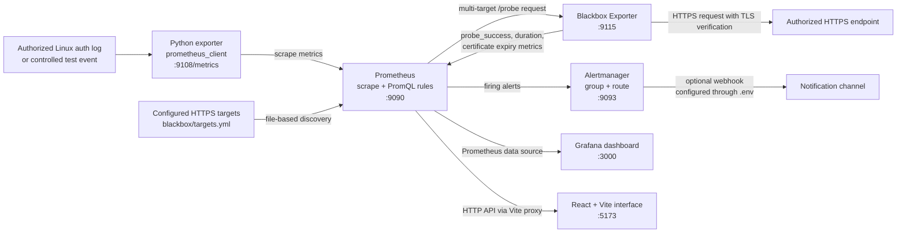

# SentinelPulse architecture

The diagram shows the local monitoring and alert path. Prometheus scrapes the exporter and evaluates its alert rules. Grafana and the React application read monitoring data from Prometheus. Alertmanager receives firing alerts; the default local setup has no notification receiver configured.

All published service ports bind to host loopback in the provided Compose configuration. The HTTPS demonstration target is configured in `blackbox/targets.yml`; replace it only with endpoints you are authorized to monitor. The notification edge is optional; an alert appearing in Prometheus or Alertmanager does not demonstrate that a notification was delivered.

## Main repository components

- `exporter/exporter.py`: controlled test-event endpoint, exporter metrics, and optional Linux auth-log tailer.
- `blackbox/blackbox.yml` and `blackbox/targets.yml`: TLS-verifying HTTP probe module and Prometheus file-discovered HTTPS target list.
- `prometheus/prometheus.yml` and `prometheus/alerts.yml.template`: scrape targets, Alertmanager address, and templated rules.
- `alertmanager/alertmanager.yml` and `alertmanager/webhook-template.yml`: default local routing and optional webhook configuration.
- `grafana/provisioning/` and `grafana/dashboards/`: Prometheus data source, dashboard provider, and saved dashboard JSON.
- `frontend/src/`: React views and Prometheus HTTP API client.
- `docker-compose.yml`: local services, ports, dependencies, health checks, and persistent data volumes.
